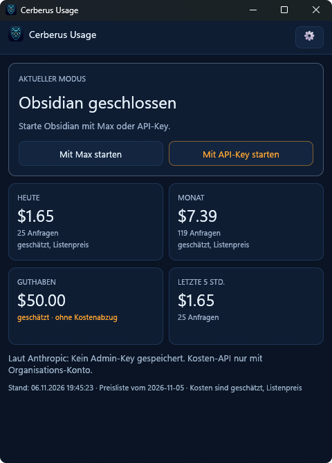

# Cerberus Usage

A small Windows tray app. It launches Obsidian with either your Claude Max subscription or an API key, and shows what Claude costs. The display makes it clear who is paying right now.



**Website and full documentation (English and German):** [cerberus-lab.de/cerberus-usage](https://cerberus-lab.de/cerberus-usage)

Windows 10/11 x86-64 only, MIT licensed, no telemetry. The interface comes in English and German; another language is just one file (see [Languages](#languages)). Button and setting names below are quoted as they appear in the English interface. This is an independent project, not affiliated with Anthropic.

## What it does

- **Launches Obsidian** in Max mode (without `ANTHROPIC_API_KEY`) or in API key mode. The key is passed to the Obsidian process only and is never set permanently. Both modes also remove `ANTHROPIC_AUTH_TOKEN` for the Obsidian process, because it would otherwise override any other login. If `ANTHROPIC_BASE_URL` or `CLAUDE_CODE_USE_BEDROCK/VERTEX/FOUNDRY` is set, it stays unchanged, but the window warns and names the variable (never its value). The "Max" or "API key" display only holds as long as no other login is configured inside Claude itself (`apiKeyHelper`, the `env` block in Claude's settings); the app cannot see that.
- **Checks whether Obsidian is running.** If the check fails (for example, `tasklist` is blocked), the app neither closes nor starts anything, and says so.
- **Locally estimated costs** from Claude's logs under `%USERPROFILE%\.claude\projects` (today, this month, last 5 hours, by project and model). Only metadata is read, never content. This is a calculation at list price, not Anthropic's invoice.
- **API costs according to Anthropic** through the cost API, if an admin key is stored.
- **Estimated balance:** the starting value from the Console, plus top-ups, minus API costs since the starting value.
- **Alerts** for the monthly budget, low balance and a Max pause: as a banner in the window and as a colored dot on the tray icon.
- **Updates:** see below.

## Install

1. Download the latest `CerberusUsage-Setup-<version>.exe` from the [releases page](https://github.com/Cerberus-Lab-de/cerberus-usage/releases) and run it.
2. The installer runs per user, without admin rights, and installs to `%LOCALAPPDATA%\Programs\CerberusUsage\`. It adds a Start menu entry; the desktop shortcut (on) and autostart (off) are checkboxes in the setup. The app appears under Windows → Apps.

**SmartScreen:** the installer is not signed with a Windows certificate (that costs money and is a separate decision). Windows therefore shows "Windows protected your PC" on first run. Click **More info → Run anyway**. If you want to check what you are running, build the app from source (see below).

**Uninstall:** Windows → Apps → Cerberus Usage. The uninstaller asks whether the settings (`settings.json`, which also holds your stored keys), the scan state and the `lang` folder should be removed too (including language files you added yourself). If you answer "Yes", it also deletes the old Credential Manager entries `cerberus-usage` that version 1.0.x may have left. If you answer "No" (and on a silent uninstall), the settings, the keys and your own language files stay; the shipped language files (`de.json`, `en.json`) go with the app. The developer's release signing key (see below) is never touched.

## Updates and signature

The app looks for a new version (this repo's releases) at startup and once a day after that. If there is one, a subtle notice appears in the cockpit. It installs only after you click "Update now", never in the background.

Every release contains a manifest file (`…exe.manifest.json`) next to the installer, with the version, file name, SHA-256 and an **Ed25519 signature**. The public key is built into the app. The private key is in the developer's Windows Credential Manager under the service name `cerberus-usage-release` (with a backup in the developer's password manager), never in the repo or on GitHub. The app installs nothing if the signature is wrong or missing, the checksum does not match, or the version is not newer than the running one. A hijacked GitHub account therefore cannot push an update. It could, however, replace the setup file for new installs (the app does not check the signature of those) and withhold updates.

The "Check for updates" switch in the settings drawer turns off automatic checks (no request goes to GitHub on its own then). The current version and "Check now" are there too.

## Privacy: what the app reads and sends

- **Reads locally:** Claude's logs under `%USERPROFILE%\.claude\projects` (or `%CLAUDE_CONFIG_DIR%\projects`), and **only metadata** such as time, model and token counts, never conversation content.
- **Sends to Anthropic** (`api.anthropic.com`) only if you have stored an **admin key**: the cost API query. Without an admin key, nothing goes to Anthropic. The normal API key goes only to the Obsidian process you start, not into the app's own requests.
- **GitHub** (`api.github.com`, `github.com` and the release download servers) is contacted **only for the update check** and the update download. Automatic checks run only while "Check for updates" is on. "Check now" and "Update now" also go out when the switch is off, because you trigger them yourself. Every request reveals your IP address and the app version to GitHub (in the user agent `cerberus-usage/<version>`); it contains nothing else.
- **No telemetry.** No usage data is sent, and there are no accounts and no server of our own.
- **Keys** are stored in `settings.json` (see below), by default **encrypted with Windows DPAPI**. Never in logs or the interface; the input fields are masked.
  - **API key** (`sk-ant-…`): only for "Start with API key". It must be assigned to a workspace (scope Default), otherwise the API rejects requests.
  - **Admin key** (`sk-ant-admin01-…`): only for the cost API.

### Keys: encrypted or plain text

DPAPI ties the encrypted keys to your Windows user on this PC. The file is useless if it is copied to another PC or user, and a key does not leak when you share or back up the file by accident. It is **not** protection against other programs: any program that runs under the same Windows user can read the keys, encrypted or not. That was just as true for the Windows Credential Manager, which 1.0.x used.

If you want to take your keys to another PC, or want a file you can read yourself, turn on "Store keys as plain text" in the settings drawer (section "Keys"; the app asks to confirm). The keys are then converted at once and stand readable in `settings.json`, also in backups and copies. Turning it off encrypts them again. To move to another PC:

1. On the old PC, turn on "Store keys as plain text".
2. Copy `settings.json` to `%LOCALAPPDATA%\CerberusUsage\` on the new PC.
3. On the new PC, turn "Store keys as plain text" off again.
4. On the old PC, turn it off again too, otherwise the keys stay readable there.

A file with encrypted keys from another PC or user cannot be decrypted. The app then marks the key as unusable and asks you to enter it again; nothing is overwritten.

**Moving from version 1.0.x:** on the first start of 1.1.0, the app moves your keys from the Windows Credential Manager (service `cerberus-usage`) into `settings.json` on its own, encrypted. The old entry is deleted only after the new one was read back and matched. If a key could not be moved, the old entry stays, a banner says so, and the next start tries again. If only the old entry could not be removed, the key is already moved: the old entry stays unused and goes away when the data is removed on uninstall. If `settings.json` itself is broken, nothing is moved. The release signing key is a different thing: it belongs to the developer, stays in the Credential Manager under `cerberus-usage-release` and has nothing to do with these settings.

### Where is the data?

Under `%LOCALAPPDATA%\CerberusUsage\`:

- `settings.json`: starting value, top-ups, monthly budget, alert threshold (amounts in nano-USD), update switch, the chosen language, the folder paths, and the API key and admin key (encrypted unless you turned on plain text)
- `scan_state.json`: read position in Claude's logs and the usage data read so far. If the file cannot be read, it is moved aside as `scan_state.json.bad` and the window says so once.
- `crash.log`: small text file with time, location and message on crashes
- `prices.json` (optional): your own price list, overrides the built-in one

If `settings.json` is broken, the app shows a message with the path, blocks saving so that the file is not overwritten, and has no keys available until the file is repaired. The keys are not lost in that case, but deleting the file would delete them too: repair it instead.

The language files are not in this folder but in `lang` next to the app, see [Languages](#languages).

## Languages

German and English ship with the app. Further languages are plain files: the app reads every `*.json` file in the `lang` folder next to the executable (by default `%LOCALAPPDATA%\Programs\CerberusUsage\lang\`). Choose the language in the settings drawer under "Language"; "Open language folder" opens the folder. The choice applies at once and is saved in `settings.json`. On the first start, the app uses your Windows display language if there is a file for it, otherwise English.

**File format:** one flat JSON file per language, UTF-8, the file name does not matter:

```json
{
  "_meta": { "code": "fr", "name": "Français", "format": 1 },
  "button.quit": "Quitter",
  "format.date_short": "%d/%m"
}
```

- `_meta.code` is the language code (for example `fr` or `pt-BR`), `_meta.name` is shown in the choice, `_meta.format` must be `1`.
- A text may contain `{placeholders}` in curly braces; the app fills them in. Keep them as in the original.
- Keys starting with `format.` hold patterns and separators (date and time patterns, the thousands separator), not texts. Amounts stay in USD with a decimal point in every language.
- A text can have the endings `.one` and `.other` for singular and plural; without `.one`, `.other` is used.
- A missing key falls back to English, and a key missing there is shown as its name. A text that is empty (or only blanks) counts as missing; only `format.thousands` may be a blank on purpose.

**Add a language:** copy `en.json` in the `lang` folder, give the copy a new name, set a new `_meta.code` and `_meta.name`, translate the values, and reopen the settings drawer. The new language appears in the choice without a restart of the app.

**Updates overwrite `de.json` and `en.json`.** The installer replaces these two files on every update, so changes you make to them are lost. For a lasting custom version, make a copy with its own code (for example `de-custom`) and edit that one. Your own files are left alone by updates.

**Only use language files you trust.** A language file controls every text of the app, including warnings, security notes and cost hints, and the app cannot tell whether a translation is faithful. A file from someone else can, for example, swap the labels of two buttons or leave out the note that costs are estimates.

**Broken files never stop the app.** The app reads at most 100 files from the folder and says so in the settings drawer if there are more. A file that is not valid JSON, has no valid `_meta`, is not UTF-8, is larger than 1 MB or has a single text longer than 4 KB is skipped, and the settings drawer says which file and why. A language code that two files provide is loaded once, from the first file. The built-in German and English keep working without the folder.

**Fonts:** Latin, Cyrillic, Greek, Chinese, Japanese and Korean display correctly if Windows has a matching font. Right-to-left scripts such as Arabic and Hebrew and scripts that need letter shaping such as Hindi do not display correctly yet.

## Other paths

If Obsidian or Claude's log folder is somewhere else, enter the path in the drawer under "Paths": field, "Browse", "Save"; "Reset" goes back to automatic. Both fields are stored in `settings.json` (`obsidian_path`, `logs_root`).

Search order for Obsidian: the configured path (must point to an existing `.exe`), then `%LOCALAPPDATA%\Programs\Obsidian\Obsidian.exe`, `%ProgramFiles%\Obsidian\Obsidian.exe`, `%ProgramFiles(x86)%\Obsidian\Obsidian.exe`. A change applies the next time Obsidian starts.

Search order for logs: the configured folder, then `%CLAUDE_CONFIG_DIR%\projects`, then `%USERPROFILE%\.claude\projects`. A change applies after restarting the app.

## Limitation: individual accounts

The cost API exists only for organization accounts. For an individual account, Anthropic answers "not available". The "API costs according to Anthropic" card then says so openly, and the balance is shown without cost deduction: starting value plus top-ups. Without the cost API, the budget alert never fires.

## All costs are estimates

Local costs are calculated at list price. According to Anthropic, cost API values can lag by several hours. The balance is a calculation from starting value, top-ups and costs, not the Console balance.

## Window and quitting

The X button hides the window to the tray. Clicking the tray icon brings it back. "Quit" in the tray menu waits until a launch in progress has finished.

## Build from source

Requirements: Windows 10/11 x86-64, Rust 1.95 or newer (stable; that is the minimum of the UI library egui 0.37, the edition is 2024) and the Visual Studio Build Tools. In PowerShell (not in Git Bash, whose `link.exe` gets in the way of linking):

```powershell
cargo test
cargo build --release
```

The app is then at `target\release\cerberus-usage.exe`. If a copy is running from there, it locks the file and the build fails: quit it first.

## Release process

For maintainers. Also required: [Inno Setup 6](https://jrsoftware.org/isinfo.php) (`winget install JRSoftware.InnoSetup`), the GitHub CLI (`gh`, logged in) and the signing key in the Credential Manager (created once with `cargo run --release --bin sign-release -- keygen --print-private-once`; back up the printed private key straight away, it cannot be read out later).

1. Bump the version in `Cargo.toml` and add a section to `CHANGELOG.md`. After any change to `Cargo.lock`, also run `python tools\third_party_licenses.py` (generates `installer\THIRD-PARTY-LICENSES.txt`, Python standard library only). Commit and push. The installer packs the `lang` folder (`de.json`, `en.json`); `tools\make_test_language.py` builds a test language `zz` from `en.json` for a visual check.
2. `.\release.ps1 -DryRun` checks tests, build and installer without signing or uploading.
3. `.\release.ps1` builds the installer into `dist\`, signs the manifest and asks "Release v… auf GitHub veröffentlichen? (j/n)". The release is created only after "j". The script never pushes commits.

CI (`.github/workflows/ci.yml`) runs tests and a release build on every push. It signs and publishes nothing.

## License

[MIT](LICENSE), Copyright (c) 2026 Cerberus Lab. The license texts of the bundled libraries (including the fonts) are in `THIRD-PARTY-LICENSES.txt`; the installer places them in the install folder together with `LICENSE`.
